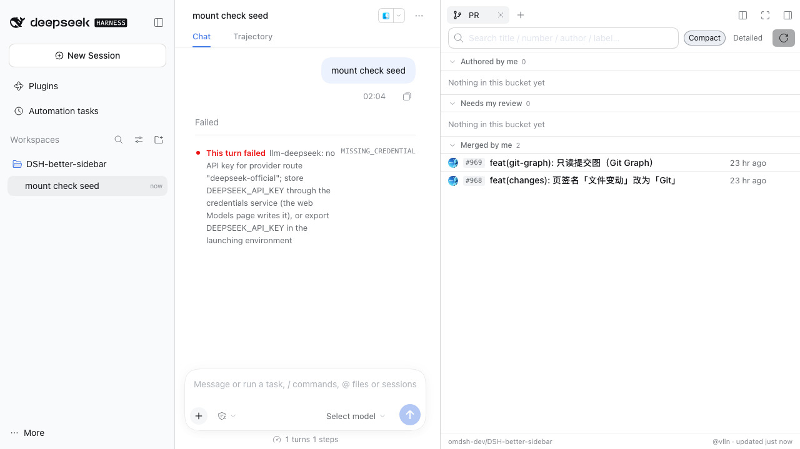
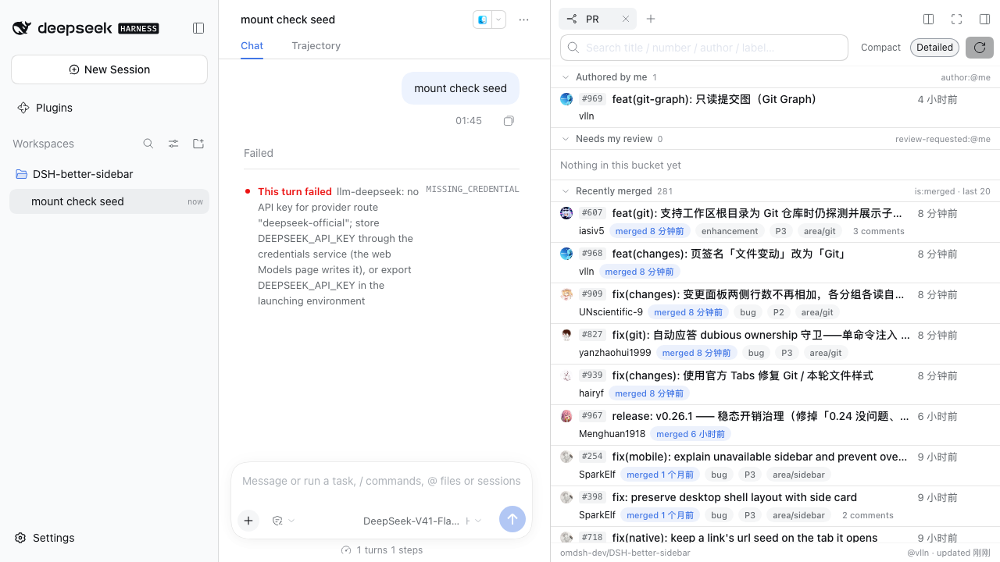
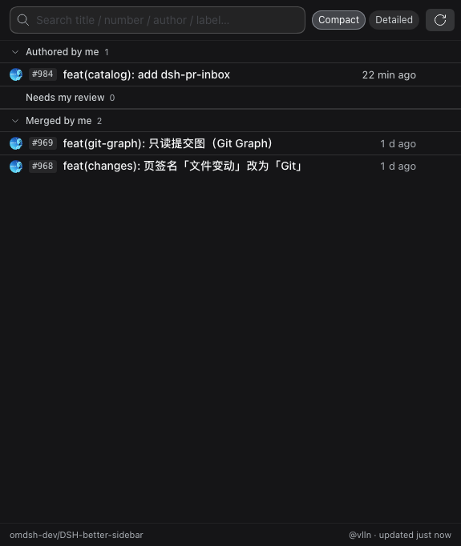
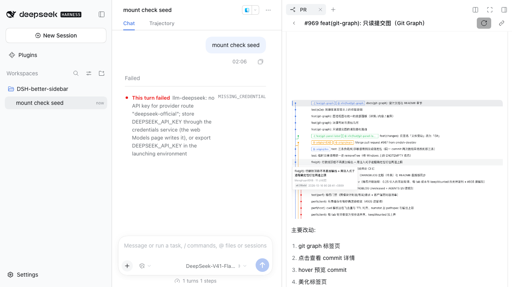

<h1 align="center">dsh-pr-inbox</h1>

<p align="center">
  侧边栏里的 GitHub PR 收件箱：<b>我提的 / 待我审 / 我合并的</b> 三桶照进 DSH 侧栏，
  一眼看完"该我动手的那几件"。绑定当前会话工作区的仓库，复用本机已登录的
  <code>gh</code>，插件不存任何凭据，只读。
</p>

<p align="center">
  
  
</p>



## 为什么需要它

"有没有该我动的 PR" 是个**每隔十几分钟就会重新出现**的问题。现在的做法通常是：
切到浏览器 → 打开 GitHub → 在 Notifications 和几个仓库的 Pull requests 页之间来回看
→ 还得自己记住哪些仓库跟自己有关。GH 的通知（网页/邮件/桌面）又是全站级别的噪音：
推送、issue、CI 失败混在一起，真正"等我 review"的那两三条淹没在里面。

这个插件把这件事挪回你**正在用的地方**：

- **绑定工作区**：不用选仓库——会话在哪个仓库，面板就是哪个仓库的 PR（`upstream`
  优先、其次 `origin`，再退到第一个 remote；fork 布局会绑到主仓而不是你的 fork）。
- **三桶就是三个动作语义**：`我提的`（我该跟进）、`待我审`（等我的动作，计数会变色）、
  `我合并的`（我刚做的事落地没有）。想扫的时候一屏扫完。
- **点开就是全文**：正文、评论与评审摘要、改动文件清单都在面板里渲染，读 PR 描述与
  讨论不用跳浏览器（看 diff / 行内 review 评论仍要 GitHub，见「已知限制」）。
- **零新凭据**：只用你**已经登录**的 `gh`。不申请 token、不填 PAT、不落盘。

与相邻方案的区别：GitHub 通知是**全站推送**（且不止 PR）；编辑器里的 GitHub 插件通常
绑在"当前文件/当前 diff"。这里是"**当前工作区 + 与我相关**"这一刀，代价是必须先装
`gh` 并登录（见下）。

## 安装

前置：DSH 已装、本机 `gh` 已登录（`gh auth login`）。面板页签挂在
[better-sidebar](https://github.com/omdsh-dev/DSH-better-sidebar) 上，所以它也要装。
**dsh 0.2.1 线需要 better-sidebar ≥ 0.28.0**：0.26.x 的 `inject` 仍要求 0.2.1 已移除的
`webRuntime`，页签会永久 pending、界面上没有任何入口。

> **当前状态：尚未发布到公开仓库**（仓库还在本地）。所以先用下面的 tarball 方式装；
> 发布后 `github:` 源那条命令才可用。

**① 装页签宿主**（两种方式都要）

```bash
dsh plugin --profile web add dsh-better-sidebar
```

**② 装本插件**

```bash
# 尚未发布：本地 tarball（需要 clone 本仓库）
pnpm install && pnpm pack                       # 产出 dsh-pr-inbox-0.1.0.tgz
dsh plugin --profile web add ./dsh-pr-inbox-0.1.0.tgz
```

```bash
# 发布后（本仓库公开时）：git 源一条命令，钉版本加 #v0.1.0
dsh plugin --profile web add "github:vlln/dsh-pr-inbox"
```

装完刷新页面（或按 DSH 提示重启 web）即可在**右侧栏**看到 `PR` 页签：
展开右栏 → 从页签列表里选 `PR`。

> `lib/` 构建产物随仓库提交，所以上面两条通道都**不需要**任何构建授权
> （不会让你放行 `allowBuilds`，也不会在你的机器上跑构建脚本）。

## 用起来是什么样

| | |
|---|---|
| **顶部** | 搜索框（标题 / 编号 / 作者 / 标签，只在已加载的行里过滤）+ `简洁/详细` 切换（选择会记住）+ 刷新 |
| **简洁档** | 单行 28px：行首头像 · `#编号` · 标题 · 时间；适合快速扫 |
| **详细档** | 两行 50px：第一行与简洁档**同一个位置**，第二行补作者、合并时间、标签、评论数 |
| **分区块** | 三个桶各自成区，滚动时当前区的名字与计数贴在上沿；点击区头折叠。只加载了一页时计数显示 `已加载 / 总数` |
| **点开一行** | 面板内打开完整 PR：正文（markdown 渲染，图片走宿主代理）、评论与评审摘要、改动文件清单（状态色标 + 增删行数）；`返回列表` 会回到原来的滚动位置与行焦点，当前项有强调条；详情里按 Esc 也能返回 |
| **状态行** | 底部常显绑定的仓库、当前 gh 账号与数据的读取时间（详情页也在） |

<p align="center">
  
  
</p>



## 能力面

| 面 | 说明 |
|---|---|
| 侧边栏页签 | `PR` 页签，挂在 better-sidebar 的右栏；跟随 DSH 语言（中/英）与深浅主题 |
| 三桶列表 | `我提的`（`author:@me`，开着的）、`待我审`（`review-requested:@me`）、`我合并的`（`is:merged author:@me`，最近 20 条，按合并时间倒序展示） |
| 行内操作 | 点行开详情；行内 `↗` 在 GitHub 打开（悬停/键盘聚焦才现形）；点击穿透不会误开外链 |
| PR 详情 | 正文、评论与评审摘要（APPROVED / CHANGES_REQUESTED 等）、改动文件清单、分支与增删行、合并/更新时间；正文与单条评论有上限并**如实标注截断** |
| 图片 | 正文与评论里的图片都会渲染：GitHub 编辑器插入的 `` HTML 形态会被改写成 markdown 图片，仓库内**相对路径**图片经插件自有路由代理取字节（受限网络下 `raw.githubusercontent.com` 不可达；同时也覆盖私有仓库） |
| 头像 | 作者头像；CDN 不可达时回退成首字母圆底——**不会出现破图图标** |
| 语言 | 界面文案随 DSH 语言（zh / en）；插件在 Plugins 页的标题与描述也有中英两份 |

## 环境与前置

- **本机 `gh` 必须已登录**：面板的数据全部来自 `gh`（列表走 `gh api search/issues`，详情走
  `gh api`）。缺 `gh` 或未登录时，面板给的是可操作提示（装 gh / `gh auth login`），
  而不是空白列表。
- **只支持 `github.com`**：其它 host（自建 GitLab / Gitea 等）会在列表里留一句说明，
  详情返回 `unsupported-host`。
- **需要 better-sidebar**：页签宿主。没装时 host 半照常工作，但界面上没有入口
  （这是有意设计：不静默失败，也不假装能用）。

## 已知限制

- **只读**：没有任何写操作——不评论、不 approve、不 merge，也不接管聊天里的 GitHub 链接。
- **`我合并的` 是最近 20 条**，不是时间窗；取数按 GitHub 搜索的 updated 取一页，展示时再按
  合并时间倒序。**搜索只在已加载的行里做**，不会去 GitHub 全量搜。
- **详情不含 diff、行内 review 评论与 CI/checks**：review 只到 review 摘要；要读某条行内意见
  或看改动本身，仍要打开 GitHub。
- **`gh` 的速率与超时**会如实反映在面板上（未登录 / 限流 / 超时各有各的提示与错误码）。
- **正文图片**只走"仓库内相对路径 + 公开/私有仓库的 `refs/pull/<n>/head`"；正文里的
  外链图片直接由浏览器加载（受限网络下可能显示不出来）。
- 面板读的是**当前工作区**：会话还没确定工作目录时，面板会提示先产生一次工具调用
  或打开文件，让它绑定到某个仓库。

## 兼容性

| dsh 版本 | 状态 |
|---|---|
| `0.2.1-rc.1` + better-sidebar `0.28.0` | ✅ 已验证（2026-10-17）：13 个门全绿（静态 9 + git 源 / mounted 浅色+深色 / negative-control / standalone） |
| `0.2.0-rc.2` + better-sidebar `0.26.x` | ✅ 已验证（2026-10-16）：真实实例里装、跑、点开详情，含 git 源安装与负控 |
| 其它版本 | ⚠️ 未验证。升级 dsh 后若**右栏没有 `PR` 页签**或**面板一直空白**，多半是宿主服务名/槽名或 client 契约变了；0.2.1 线先确认 better-sidebar ≥ `0.28.0` |

## 插件管理

装/卸/启停用官方 CLI：`dsh plugin --profile web add|remove <包>`；已装插件在**侧边栏
Plugins 页**里查看与配置——每个插件自己的配置页挂在那个包页上（Settings 里的「插件」
只是只读清单，改不了配置）。

## 开发与验证

```bash
pnpm install && pnpm build        # 改源码后必须重建并提交 lib/（CI 会校验无漂移）
node scripts/gates/run.mjs        # 静态门：包契约 / 发布卫生 / 决策记录 / 文档链接 / 产物新鲜度 / 单测
node scripts/gates/run.mjs --list # 还有哪些实例门（真装真跑、负控、git 源安装冒烟）
```

工程备忘录（机制、实测环境事实、验证证据、决策记录索引）在
[docs/engineering-notes.md](docs/engineering-notes.md)。

## 许可

MIT